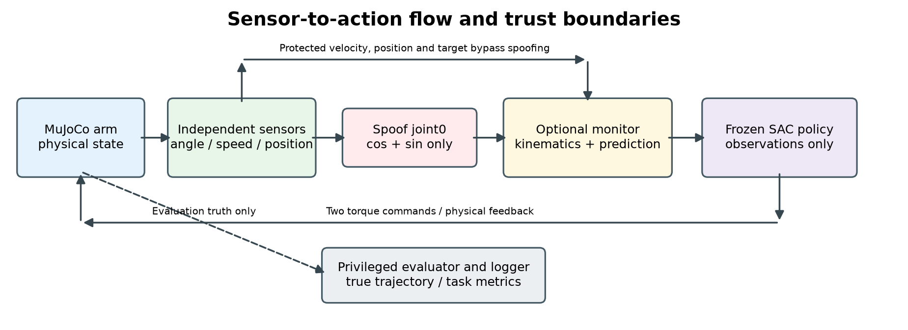

# Joint Sensor Spoofing and Kinematic Mitigation in an RL Robotic Arm

DASE7508 Security of Intelligent Systems | Group Project Proposal

Team members and student IDs are listed in Section 6. Contact person: **LAM Fu Shing (3036705826)**.

## 1. Question and motivation

If one joint-angle sensor gives incorrect readings, how much will this affect a trained robotic arm? Can we detect the problem using the arm’s kinematics and reduce its effect?

We plan to test this using a simulated two-joint arm controlled by reinforcement learning (RL). If an encoder reports the wrong angle, the controller may choose unsuitable torques and move away from its target. Earlier work has shown that neural-network policies can be affected by adversarial observations [1]. Our project focuses on one specific sensor fault: we will measure its effect on reaching and test whether a simple kinematic check helps. We have not run these experiments yet.

## 2. System and threat model

We will adapt Gymnasium Reacher-v5 with a Stable-Baselines3 Soft Actor-Critic (SAC) policy [2–5]. The arm moves its fingertip towards a target using two joint-torque commands. The 10-dimensional Reacher-v5 observation contains cosine/sine joint encodings (indices 0–3), target coordinates (4–5), angular velocities (6–7), and planar fingertip-to-target displacement (8–9) [2]. We will explicitly configure a 100-step episode limit for both training and evaluation instead of the default 50 steps.

Our aim is to keep the arm reaching reliably even when one sensor reading is false. We assume the attacker can change only the angle reported for joint0; how the attacker gains that access is outside this project. During one window per episode, it reports q0′ = q0 + δ(t), with |δ(t)| ≤ ε, and consistently replaces both sine and cosine entries. It cannot alter joint1, velocities, target, position measurements, rewards, physical state, policy weights, or monitor code. Neither attack needs access to the policy’s internal parameters.

Independent joint-velocity and fingertip-position channels are assumed protected against this compromise. The wrapper derives them from simulator state before attack injection; nominal position noise is Gaussian with σ = 0.002 m per coordinate. The policy receives the environment-defined fingertip-to-target displacement with added nominal sensor noise; the monitor reconstructs the fingertip position using that displacement and the trusted target. The displacement sign and observation indices will be checked against the installed environment version. This independence is part of our simulation setup, not a claim about real hardware. The monitor sees reported observations and nominal geometry, never true joint angles. We use the simulator’s true state only to create the separate sensor readings and evaluate results afterward.

Figure 1. Sensor-to-action flow and trust boundaries. Without the monitor, the reported encoder values pass directly to the policy. The evaluator’s privileged state never feeds the policy or monitor.

## 3. Technical approach

We will train an MLP SAC policy on clean observations with the same nominal position noise, then freeze its weights and use deterministic actions for all comparisons. We will build a wrapper to generate sensor readings, insert attacks, apply corrections, and save logs. In Week 1, we will check the observation indices, confirm that the trusted channels bypass the attack, and compare our kinematic calculations with MuJoCo. We will read link lengths and fingertip offsets from the model.

We will test two attacks: a fixed angle offset and an offset that gradually increases. Both will update the sine and cosine values consistently. We will also test random-sign disturbances with the same magnitudes and durations to see whether a deliberate pattern matters.

The monitor computes r(t) = ||f(q0′, q1) − p_measured(t)||₂. Its threshold is the empirical 99th percentile of step residuals from 100 separate clean calibration episodes per policy, fixed before testing. On an alarm it replaces only joint0’s sine/cosine pair using a predicted angle: q̂0(t) = wrap(q̂0(t−1) + q̇0(t−1)Δt). Here Δt is the actual environment control interval and q̇0 is trusted. At the first alarm, prediction starts from the last accepted angle; subsequent alarm steps propagate the estimate. A non-alarm observation is accepted again. More than 20 consecutive alarm steps ends the simulated trial and counts as task failure; this is an experimental abort, not a validated physical safety stop.

We will save sensor readings before and after correction, monitor alarms, torques, and actual trajectories. Comparing runs with the same starting conditions will help us see when a false reading changes the arm’s movement. We will also look at attacks the monitor misses.

## 4. Evaluation plan

The primary sweep uses ε ∈ {0.02, 0.05, 0.10} radians, durations {5, 20} steps, and {bias, ramp}: 12 settings. Windows start at observation step 20, indexed from zero; attack signs are balanced. Three independently trained policies each use 30 held-out initial-state/target pairs, with matched reset and sensor-noise seeds across conditions. Clean validation, calibration, and test sets are disjoint.

| Input | Monitor off | Monitor on |
| --- | --- | --- |
| Clean | Normal baseline | Normal-performance cost |
| Matched random-sign disturbance | Noise control | Noise/intervention cost |
| Bias or ramp spoofing | Attack impact | Detection and recovery |

We will reuse the same clean runs across settings: 3 × 30 × (2 clean conditions + 12 settings × 4 corrupted conditions) = 4,500 evaluation episodes, at most 450,000 steps. Bias and ramp are evaluated separately even though grouped in the comparison table.

Task success requires mean true fingertip-to-target distance ≤ 0.03 m over the final 10 steps and no abort. Attack success is a clean-successful trial becoming a failure under attack. For each policy, the same unprotected clean-success set is the denominator with and without mitigation; we will report its size, unconditional task success, and paired success differences across all trials.

An arm might recover by the end of an episode even after moving off course. We will therefore also measure its average and maximum distance from the target during the attack and the next 10 steps, comparing these with clean runs. Secondary measures are terminal error, control effort Σ||a(t)||², abort rate, and monitor processing latency on the specified machine. Detection delay is the first alarm within the attack window minus the window start; trials with no such alarm are reported as missed detections. Clean false alarms are reported both per step and per episode. Recovery time is the number of steps after the attack ends until true distance remains ≤ 0.03 m for five consecutive steps; unrecovered/aborted trials are reported separately.

We will show results for each trained policy, along with averages, ranges, and examples of unsuccessful attacks. If an attack has little effect, or if the monitor makes performance worse, we will report that too. We may separately test other attack start times or position-noise levels, using fresh clean calibration data when needed. After the Week 1 pilot, the group can adjust the controller, sensing setup, or experiment size if necessary and record why. We will agree on the main test settings and success criteria before running the final experiments; later exploratory tests will be reported separately.

## 5. Feasibility and limitations

The prototype needs Python, Gymnasium, MuJoCo, Stable-Baselines3, NumPy, and plotting tools on one available computer; 16 GB RAM is preferred and a GPU is optional. Data are generated locally in simulation. Training is budgeted at up to 500,000 steps per seed (1.5 million total), with a 24-hour wall-clock cap on the chosen machine. In Week 1, we will run a small test to estimate training and evaluation time, check sensor consistency, and see how well the arm reaches its target. We will then confirm whether the planned budget is realistic. No hardware purchases, cloud rental, or paid APIs are planned; local electricity and storage are the remaining costs.

The main risk is weak clean reaching. Week 1 requires at least 24 successes in 30 separate validation episodes per retained policy. If the pilot shows the time budget cannot support three qualified policies, we will reduce the number of seeds before main testing and disclose the weaker evidence about training variability. If SAC cannot produce a usable baseline, we will use an inverse-kinematics target and PD joint controller in the same simulator, documenting this decision before testing and narrowing claims to feedback-control security rather than RL vulnerability.

The SAC policy already receives information about the fingertip’s position relative to the target, so it may still work well when joint0 is corrupted. Small or gradual attacks may also be hard to detect, and angle prediction can drift over time. These outcomes are worth studying. Our results will apply to this simulated arm, not directly to a real robot or its physical safety systems.

## 6. Team plan and milestones

The responsibilities below are our proposed starting point. Everyone will also help review another module, write the report, and prepare to explain the results. LAM Fu Shing is the group leader and contact person.

| Member | Student ID | Proposed responsibility |
| --- | --- | --- |
| LAM Fu Shing | 3036705826 | Leader/contact; integration, reproduction, report coordination |
| Wu Houlin | 3036863317 | Reacher setup, SAC training, clean validation |
| XI Youran | 3036800872 | Sensor wrapper, bias/ramp attacks, matched controls |
| Hu Jiayang | 3036802868 | Kinematic monitor, calibration, recovery logic |
| Zhang Yusi | 3036804581 | Paired evaluation, metrics, plots, analysis |

| Time after proposal | Milestone |
| --- | --- |
| Week 1 | Verify sensor/geometry consistency, benchmark runtime, validate clean policies, and document any pre-test plan adjustment or fallback. |
| Week 2 | Integrate attacks/monitor; freeze configurations, thresholds, metrics, and test seeds. |
| Week 3 | Run paired trials and selected sensitivity checks; analyse missed and ineffective attacks. |
| Week 4 | Complete analysis, report and demo; reproduce a sample from a clean installation. |

We will keep our code, dependencies, trained models, test seeds, results, and setup instructions on GitHub so the experiments can be repeated. AI tools helped with drafting and editing this proposal. We will check any AI-assisted code or analysis ourselves and describe actual AI use and individual contributions in the final report. All tests will use our own simulator.

## References

[1] S. Huang et al. “Adversarial Attacks on Neural Network Policies.” arXiv:1702.02284, 2017. [Link](https://arxiv.org/abs/1702.02284)

[2] Farama Foundation. “Reacher.” Gymnasium documentation. Accessed 9 October 2026. [Link](https://gymnasium.farama.org/environments/mujoco/reacher/)

[3] T. Haarnoja et al. “Soft Actor-Critic: Off-Policy Maximum Entropy Deep Reinforcement Learning with a Stochastic Actor.” arXiv:1801.01290, 2018. [Link](https://arxiv.org/abs/1801.01290)

[4] A. Raffin et al. “Stable-Baselines3: Reliable Reinforcement Learning Implementations.” JMLR, 22(268):1–8, 2021. [Link](https://jmlr.org/papers/v22/20-1364.html)

[5] Stable-Baselines3 contributors. “SAC.” Documentation. Accessed 9 October 2026. [Link](https://stable-baselines3.readthedocs.io/en/master/modules/sac.html)
